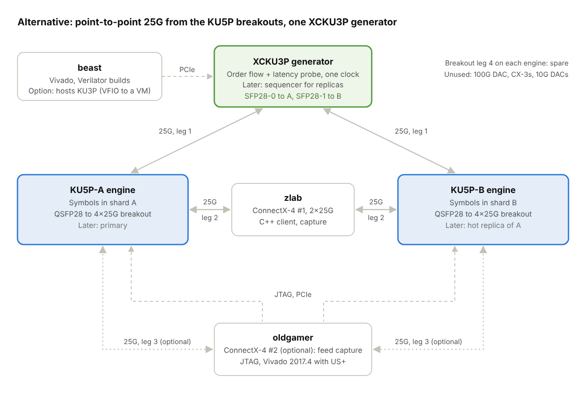

# Alternative arrangement: 25G links, XCKU3P as the order generator

Nov 23, 2026 · Denis Zhereshchin

This is an alternative to the board arrangement in the [design plan](design-plan.md). The design plan and its [topology diagram](diagrams/topology.png) stay as they are. Everything not mentioned here (engine modules, book structures, protocol, golden model, milestones' exit tests) is unchanged.

**What changes**

- The single XCKU3P card (Alibaba, dual SFP28) replaces both xc7k325t boards as the order generator and latency probe.
- Every data link runs at 25G (25GBASE-R) instead of 10G.
- Each KU5P's QSFP28 cage fans out through a 100G-to-4x25G breakout; all 25G links originate from those breakout legs.
- zlab uses a dual-port ConnectX-4 (25G) instead of the ConnectX-3.

## Topology

Solid lines are 25G breakout legs, dotted lines are optional 25G legs, dashed lines are control and build paths. There is still no switch: each breakout leg is an SFP28 plug that goes straight into an SFP28 cage on the KU3P or a ConnectX-4.

| KU5P breakout leg | KU5P-A goes to | KU5P-B goes to |
| --- | --- | --- |
| Leg 1 | KU3P SFP28-0 | KU3P SFP28-1 |
| Leg 2 | zlab ConnectX-4 #1, port 0 | zlab ConnectX-4 #1, port 1 |
| Leg 3 (optional) | ConnectX-4 #2, port 0 (feed capture) | ConnectX-4 #2, port 1 (feed capture) |
| Leg 4 | Spare | Spare |

| Board or host | Role in this arrangement | Links |
| --- | --- | --- |
| KU5P-A | Engine, symbol shard A; later primary | QSFP28, 4x25G breakout |
| KU5P-B | Engine, symbol shard B; later hot replica of A | QSFP28, 4x25G breakout |
| XCKU3P | Order generator and latency probe for both engines; sequencer in replica mode | SFP28-0 to KU5P-A, SFP28-1 to KU5P-B |
| zlab | C++ reference engine, software client and pcap capture | ConnectX-4 #1: port 0 to KU5P-A, port 1 to KU5P-B |
| oldgamer | JTAG and Vivado 2017.4 (has UltraScale+); optional host for ConnectX-4 #2 as a dedicated feed capture | Leg 3 of each engine, optional |
| beast | Builds; one option for hosting the KU3P | PCIe |

**What gets simpler.** One generator drives both engines from one free-running counter, so latency on both engines is measured on a single clock, and the replica-mode sequencer (M6) is the same board that already feeds both engines. Generator RTL is written once for one board instead of two.

**What is lost.** The 325T-2 DDR capture of market data. Capture moves to software (ConnectX-4 on leg 2 or leg 3, pcap), or to the KU3P's own DRAM if the card has any (unconfirmed). The CRC-64 digest check still runs on the KU3P for every reply and feed message it receives, which is the main correctness check anyway.

**Still no direct KU5P-to-KU5P link.** With both QSFP28 cages used by breakouts, the 100G-to-100G DAC has nowhere to go. If a KU5P turns out to have a second QSFP28 cage, that DAC between the two engines (at 100G or 4x25G) becomes a replication path that does not go through the KU3P.

## Can the KU5P run 4x25G?

Very likely yes, with little margin to spare. To confirm on the board:

- **Cage.** The vendor docs for the board (see [boards/ku5p](../boards/ku5p/README.md)) list a QSFP28 cage, not QSFP+. A QSFP28 cage runs 4x25G, 40G (4x10G) and 4x10G breakouts.
- **Transceiver speed.** The board's part is XCKU5P-1FFVB676 (speed grade -1). DS922, Table 1 lists the GTY maximum line rate at VCCINT 0.85 V as 28.21 Gb/s for -2 and 25.785 Gb/s for -1 ([DS922 GTY switching characteristics](https://docs.amd.com/r/en-US/ds922-kintex-ultrascale-plus/GTY-Transceiver-Switching-Characteristics)). 25GBASE-R is 25.78125 Gb/s, so a -1 part runs it, at its rated limit. FFVB676 is not in the footnote of package-limited packages (that list caps SFVB784 at 12.5 Gb/s and FFVA676 and others at 16.3 Gb/s). Read the column mapping again against the PDF table before relying on it, and check that the board runs VCCINT at 0.85 V, not a low-voltage -1L setting (the 0.72 V column drops -1 to 12.5 Gb/s).
- **Datapath width.** For -1 parts above 12.5 Gb/s the GTY must use a 64-bit or 80-bit internal data path (DS922, Table 6 note 6). That fits 64b/66b at 25G.
- **Reference clock.** 25.78125 Gb/s works from a 156.25 MHz reference (QPLL0 at 12.890625 GHz, inside its 9.8 to 16.375 GHz range) or from 161.1328125 MHz. Check which oscillator drives the QSFP28 quad's MGTREFCLK and whether it is programmable.
- **Lane map.** Same open question as for 10G: which GTY lane goes to which breakout leg, and polarity swaps on the board.

The same checks apply to the KU3P's two SFP28 cages, plus its speed grade (read it off the chip; it is not known yet).

## Parts to buy

| Item | Need | Why |
| --- | --- | --- |
| Second QSFP28-to-4xSFP28 breakout DAC (100G to 4x25G), passive, 1 to 2 m | **Required** | Only one is on hand. Without it KU5P-B cannot run at 25G |
| One SFP28-to-SFP28 25G DAC, short | Recommended | Loops KU3P SFP28-0 to SFP28-1 to measure the generator's own TX and RX latency, which is subtracted from every round trip. The 10G SFP+ DACs on hand are not rated for 25G; a short one may work but would add bit errors to the calibration |
| Powered PCIe riser, or 12 V supply for the card | Only for the standalone KU3P option | See below |

Not needed in this arrangement: the 40G-to-4x10G breakout (kept as a fallback), the 100G-to-100G DAC, both ConnectX-3s and the 10G SFP+ DACs.

**Interim with what is on hand.** Until the second breakout arrives, run KU5P-A on the 25G breakout and KU5P-B on the 40G-to-4x10G breakout at 10G. The KU3P's SFP28 cage and the ConnectX-4 both run 10G on the same leg, so only the KU5P-B port and KU3P SFP28-1 change rate. Every 25G MAC should keep a 10G build option anyway for bring-up.

## Where the KU3P lives

Every design keeps its PCIe x1 endpoint for programming and configuration, including the KU3P's, whichever option is used.

| Option | For | Against |
| --- | --- | --- |
| **beast**, passed through to a VM (VFIO) | Plenty of PCIe lanes; the build box can load and test new generator images right after building them | A flash update plus ICAP reboot drops the link; under passthrough the VM needs a remove and rescan, and some host or VM restarts may be needed when the link does not come back. Builds and tests share one machine |
| **Standalone** (powered riser or 12 V) | No host to manage; the generator runs from its flash image | Configuration (seed, rate, start/stop, reading CRC digests and latency histograms) needs another path: a small UDP control message on a spare port, or JTAG. Needs PCIe for flash updates anyway, so it suits a stable generator image, not bring-up |
| **oldgamer**, now that the 325Ts are gone | Free CPU x16 slot; oldgamer already has the JTAG hw_server and Vivado 2017.4 with UltraScale+ | Shares the box with the optional ConnectX-4 #2 |

Recommended: bring the KU3P up in beast (or oldgamer, if VFIO resets get in the way), and move it to standalone once the generator image is stable and has a UDP control path.

## Engine and RTL changes

- **MAC/PHY.** Same open-source 64b/66b PCS and MAC as the 10G plan (Alex Forencich's code supports 25G on GTY), at 25.78125 Gb/s. The 64-bit user interface runs at about 402.8 MHz. That is hard to close on a -1 KU5P; the fallback is a 128-bit user interface at about 201.4 MHz, which costs one or two cycles (5 to 10 ns). Xilinx's 25G MAC (xxv_ethernet) needs a paid licence and is avoided.
- **No FEC, no auto-negotiation.** Passive DACs of 1 to 2 m run clean without FEC. On the ConnectX-4 ports set the speed and turn FEC and auto-negotiation off, for example `ethtool -s <if> autoneg off speed 25000` and `ethtool --set-fec <if> encoding off`.
- **Clock crossing.** The ingress arbiter crosses from about 402.8 MHz (or 201.4 MHz) to the 250 MHz core. The core clock and the book are unchanged.
- **Throughput.** A 25G port carries far more 32-byte messages than the current `book_core` (about 15 cycles per message, roughly 16 million messages per second at 250 MHz) can take. The generator must pace its output, and the ingress FIFO back-pressure is what keeps a burst from being dropped.
- **Vivado.** Check that the Vivado on oldgamer (2017.4) lists the XCKU3P with GTY support, as it does for the KU5P. A newer Vivado would be needed otherwise.
- **KU3P board facts to collect.** PCIe lane 0, reference clock and PERST# pins, QSPI flash part, SFP28 cage pins (TX_DISABLE, MOD_ABS), reference clocks for the SFP28 quad, LEDs, and whether there is DRAM.

## Latency estimate

Design estimates, not measurements, on the same basis as the design plan (last bit of the request in to first bit of the reply out).

| Stage | 10G plan (ns) | 25G (ns) |
| --- | --- | --- |
| GTY RX, 64b/66b PCS, MAC RX | 100 to 150 | 60 to 100 |
| UDP parse, clock crossing, ingress arbiter | 30 to 50 | 30 to 50 |
| Validate and route | 10 to 15 | 10 to 15 |
| Book core: add that rests, or one fill | 25 to 50 | 25 to 50 |
| Event build, UDP TX framing | 20 to 30 | 20 to 30 |
| MAC TX, PCS, GTY TX | 80 to 120 | 50 to 80 |
| **Total** | **265 to 415** | **195 to 325** |

The PCS and MAC stages shrink because they run at a faster clock with fewer bits per beat to gather. Serialization of the frame itself is not in either total, but a store-and-forward parser waits for the whole frame: a one-message packet (about 110 bytes on the wire) takes about 35 ns at 25G against about 88 ns at 10G.

## Milestones in this arrangement

- **M0** adds: confirm the KU5P runs 25GBASE-R on its QSFP28 lanes, the KU3P speed grade and pinout, and the KU3P's PCIe x1 endpoint.
- **M3** becomes 25G first light: UDP echo between the KU3P and KU5P-A at 25G for an hour with zero errors. Bring the link up at 10G first on the same cables, then switch rate.
- **M4** runs the generator on the KU3P instead of 325T-1.
- **M5** uses both KU3P ports, one per engine, and captures market data on zlab (or ConnectX-4 #2) instead of 325T-2 DDR.
- **M6** uses the KU3P as the sequencer, sending one identical stream out of both SFP28 ports.

## Open questions

- [ ] Second 100G-to-4x25G breakout bought.
- [ ] KU5P: VCCINT 0.85 V, QSFP28 quad reference clock, 25G link on all four lanes.
- [ ] KU3P: speed grade, SFP28 quad reference clock, PCIe pins, flash part, DRAM.
- [ ] Vivado 2017.4 device support for the XCKU3P.
- [ ] 64-bit at 402.8 MHz or 128-bit at 201.4 MHz MAC interface on the -1 KU5P.
- [ ] Where the KU3P lives: beast, oldgamer or standalone.
- [ ] Slot in zlab for the ConnectX-4 (PCIe Gen3 x8 card).
