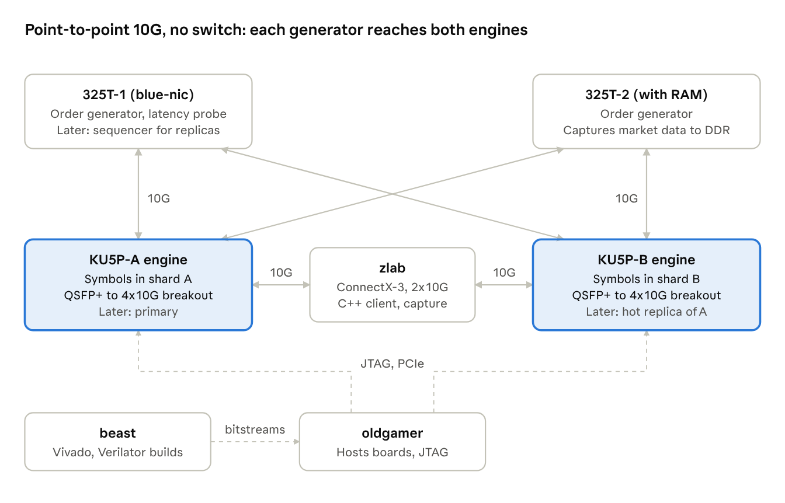
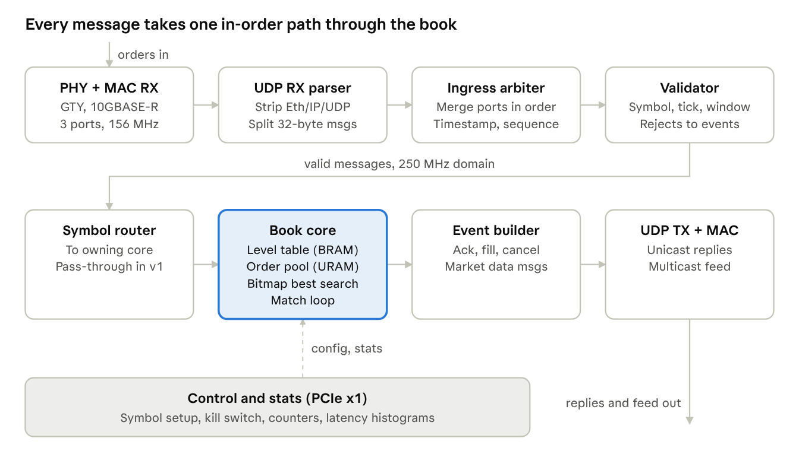
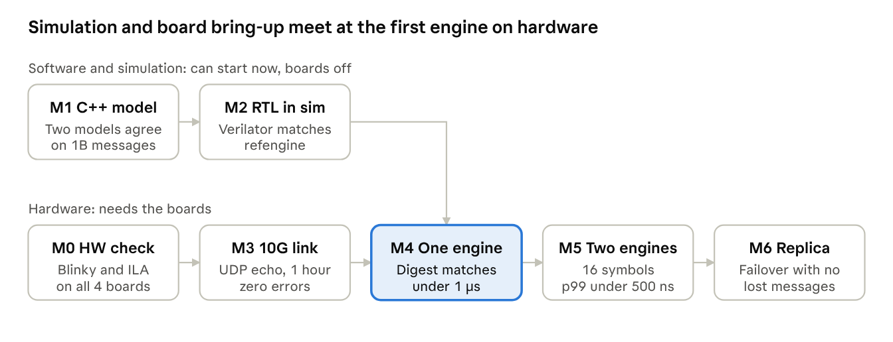

# FPGA matching engine prototype: architecture and plan

Nov 22, 2026 · Denis Zhereshchin

Live version: https://claude.ai/artifact/3H7usxuKeUTqbh9wAXvQ9J

## Goal and scope

The prototype is a price-time-priority limit order book and matching engine running entirely in fabric on the two XCKU5P boards, fed by order flow from the two xc7k325t boards over 10G UDP, and checked message-for-message against a C++ reference engine.

**In scope for v1**

- A few symbols per engine (start with 1, then 4 to 16), each with a fixed tick grid and a fixed price window held on chip.
- Limit orders (Day and IOC), cancel, and reduce-quantity. Price-time priority, no hidden or iceberg orders.
- One binary protocol over Ethernet/IPv4/UDP at 10G: orders in, acks and fills out, plus an order-by-order market data feed.
- A deterministic engine: the same input sequence always produces byte-identical output. Testing, replication and debugging all rest on this.
- A wire-to-wire latency measurement, taken on the order generator boards.

**Not in v1:** FIX/OUCH/ITCH compatibility, market orders and stops, auctions, risk checks, multi-session fairness, persistence and recovery, DDR4, and the host PCIe path beyond control. Each one is a later milestone, not a redesign, as long as the core stays deterministic.

## Boards and links

Both KU5Ps run the same engine bitstream, each owning half the symbols, and both 325Ts drive order flow into both of them. There is no switch, so every link is a point-to-point DAC: each KU5P's QSFP+ port fans out through a 40G-to-4x10G breakout, and each leg plugs straight into a 325T SFP+ cage or a ConnectX-3 port. Sharding by symbol needs no link between the engines, so it is the v1 mode. Because the engine is deterministic, KU5P-B can later become a hot replica of KU5P-A, with 325T-1 acting as the sequencer that sends one identical input stream to both.

Solid lines are 10G point-to-point DACs, dashed lines are control and build paths. Every engine port has a dedicated peer, so there is no switch latency or contention in any measurement.

| Board | v1 role | Later role | Links |
| --- | --- | --- | --- |
| KU5P-A | Engine, symbol shard A | Primary engine | QSFP+ 40G-to-4x10G breakout: leg 1 to 325T-1, leg 2 to 325T-2, leg 3 to zlab ConnectX-3, leg 4 spare |
| KU5P-B | Engine, symbol shard B | Hot replica of A, fed by the sequencer | Same breakout and leg mapping as KU5P-A |
| 325T-1 (blue-nic) | Order generator and latency probe | Sequencer for replica mode; host-driven client via PCIe Gen2 | SFP+ 0 to KU5P-A, SFP+ 1 to KU5P-B |
| 325T-2 (with RAM) | Order generator and market data capture into its DDR | Replay of recorded sessions from DDR | SFP+ 0 to KU5P-A, SFP+ 1 to KU5P-B; 1G RJ45 for control |
| XCKU3P (25G) | Spare | 25G engine port, paired with a ConnectX-4 25G | Dual SFP28 |
| zlab | C++ reference engine and harness; software client and pcap capture through a dual-port ConnectX-3 | Same | ConnectX-3 port 1 to KU5P-A, port 2 to KU5P-B |
| beast | Vivado and Verilator builds, regression runs | Same | Build VM |
| oldgamer | Hosts boards for JTAG, power and PCIe | Same | JTAG and PCIe |

Each 325T timestamps a request as it leaves and the response as it arrives, on the same clock, so round-trip latency needs no clock sync between boards. The ConnectX-3 link from zlab gives a third order source with a C++ client, and lets tcpdump capture every reply and feed packet from either engine. The second ConnectX-3 and the two ConnectX-4 25G cards are spares; one ConnectX-4 pairs with the XCKU3P later.

**PCIe slot plan.** The engines and the software client share zlab; the generators share oldgamer; beast stays a build host. Every FPGA design only uses x1, so any slot that physically fits the card works. Slot layouts below are from typical boards of each chipset and need checking on the machines.

| Host | Slots (expected) | Goes there | Why |
| --- | --- | --- | --- |
| zlab (X99, i7-5820K, 28 CPU lanes) | 3 to 4 full-length slots, about x16/x8/x4 | KU5P-A, KU5P-B, ConnectX-3 (in an x8 or wider slot) | One host controls both engines and runs the C++ client and capture on the same breakout legs. The 5820K has no integrated graphics, so it runs headless or needs one more slot for a GPU |
| oldgamer (Z77, i5-3570K) | 2 full-length (CPU x16, chipset x4), 2 x1, some legacy PCI | 325T-1 in the CPU x16, 325T-2 in the chipset x4 | Both generators on one host; the i5's integrated graphics frees both long slots |
| beast (Proxmox) | Server board, many lanes | Nothing in v1 | Stays a build host. Later candidate for the XCKU3P and a ConnectX-4 25G, passed through to a VM |
| dell7440 | None | Nothing | Laptop |

Spares: the second ConnectX-3 and both ConnectX-4s. Check that each FPGA card's power draw fits its slot: a full-length slot gives up to 75 W, while an x1 slot is only guaranteed 10 to 25 W.

## Engine modules and datapath

The engine is a single in-order pipeline: packets in, one message at a time through the book, events out. Every module speaks AXI-Stream, so each can be unit-tested alone in Verilator and the MAC can be swapped without touching the core.

The top row runs on the MAC clock and ends at the ingress arbiter, which fixes the one order every later stage sees. The bottom row runs at 250 MHz; rejects skip the book and go straight to the event builder.

| Module | Job | Clock |
| --- | --- | --- |
| 10GBASE-R PHY + MAC | GTY transceiver, 64b/66b PCS, MAC. Open source (Alex Forencich's verilog-ethernet or its successor) to avoid Xilinx MAC licences | 156.25 MHz, 64-bit |
| UDP RX parser | Drops non-matching frames, strips Eth/IP/UDP, checks session and sequence, splits a packet into fixed 32-byte messages | 156.25 MHz |
| Ingress arbiter + timestamp | Merges the 2 to 3 order ports into one stream in arrival order, stamps a 64-bit ns timestamp and an engine sequence number. This is where determinism is fixed | crosses to 250 MHz |
| Validator | Checks symbol, tick, price window, quantity, order handle generation; emits rejects | 250 MHz |
| Symbol router | Sends the message to the book core that owns its symbol | 250 MHz |
| Book core (one per symbol group) | Price-level arrays, order pool, best-price search, matching loop | 250 MHz target |
| Event builder | Turns book results into ack, fill, cancel-ack and market data messages | 250 MHz |
| UDP TX | Packs messages into frames: unicast replies per session, one multicast feed per engine | back to 156.25 MHz |
| Control and stats | Symbol table setup, kill switch, counters, latency histograms. Reached over PCIe x1 from day one, JTAG only as a fallback | AXI-Lite |

In v1 there is one book core and the router is a pass-through. Several cores in parallel, each owning a group of symbols, is how throughput scales later; message order is still fixed once at the ingress arbiter.

**PCIe x1 in every design.** All four boards (both KU5Ps and both 325Ts) carry the same small PCIe x1 endpoint in their static logic, so each is programmed and configured from its host without a JTAG cable. It provides:

- One BAR mapped to AXI-Lite: symbol table, kill switch, counters, latency histograms, generator seeds and the CRC-64 digests.
- Flash update: the host writes a new bitstream to the board's QSPI flash through the endpoint, then triggers a warm reboot through ICAP (IPROG). A golden fallback image stays in flash so a bad update never bricks a board.
- One small host tool in C++ over `/dev/mem` or VFIO (`fpgactl`) for all four boards: load, reboot, read and write registers, dump stats.

x1 at Gen2 is plenty for control. The Xilinx integrated PCIe block is used (no licence needed), with the AXI bridge or XDMA only where DMA is wanted later for the drop copy. PCIe tandem configuration and partial reconfiguration are possible later but not needed for v1.

## Book structures on chip

Each symbol's book is a fixed window of 4,096 price levels per side, indexed directly by tick, over an order pool in URAM that links resting orders into per-level FIFOs. No hashing, no sorting, no DDR: every lookup is one memory address computed from the message.

**Price index.** `level = (price_ticks - base_ticks)`, with `base_ticks` set per symbol at start of day and the window centred on the reference price. An order outside the window is rejected in v1.

**Order handle.** The engine, not the client, picks the order ID: it is the pool slot index plus an 8-bit generation counter. A cancel therefore goes straight to its slot, and a stale handle is caught by the generation check. The client's own order ID is carried through and echoed back but never looked up.

**Memories, per book core**

| Structure | Contents | Size | Memory |
| --- | --- | --- | --- |
| Order pool | qty, price level, side, symbol, client order ID, prev, next, generation | 64K orders x 144 bits | 32 URAM (2 wide x 16 deep) |
| Free list | Free slot indices, popped on add, pushed on remove | 64K x 16 bits | 32 BRAM36 as a FIFO |
| Level table | Head, tail, total qty and order count per level | 2 sides x 4,096 levels x 64 bits, per symbol | BRAM, 16 BRAM36 per symbol |
| Level bitmap | 1 bit per non-empty level, as 64 words of 64 bits plus a 64-bit summary word | 2 x 4,096 bits per symbol | LUTRAM / registers |
| Best price | Current best bid and best ask level per symbol | 2 x 12 bits | Registers |

The XCKU5P has about 64 URAM and about 480 BRAM36 (to confirm in Vivado's device report), so one 64K-order pool plus 16 symbols of level tables (about 290 BRAM36) fits with room left for the MAC and FIFOs.

**Price-level FIFO.** Each level is a doubly linked list through the pool: append at the tail on add, match from the head, unlink from anywhere on cancel. All three are O(1) and touch at most three pool entries plus one level entry.

**Best-price search.** Best bid and best ask live in registers and are updated as orders arrive. A search is needed only when the best level empties: a find-first-set on the summary word picks the 64-bit word, a second find-first-set inside it picks the level. Bids search for the highest set bit, asks for the lowest. That is two pipelined priority encoders, about 2 cycles.

**Matching loop.** For an incoming order that crosses:

1. Read the head order at the opposite best level.
2. Fill `min(incoming_qty, resting_qty)`, emit a fill for both sides and an execute on the feed.
3. If the resting order is used up, unlink it and free its slot. If the level is now empty, clear its bitmap bit and search for the next best level.
4. Repeat while quantity remains and the price still crosses. The remainder rests (Day) or is cancelled (IOC).

One fill iteration costs about 4 to 6 cycles at 250 MHz, bounded by URAM read latency. Because a large order can sweep many levels, the core back-pressures the ingress FIFO while it works: latency for that message grows with fills, but nothing is reordered or dropped.

## Wire protocol

Every message is a fixed 32 bytes, little-endian, batched up to 32 per UDP packet behind a 16-byte packet header. Fixed size means the FPGA parser is four 64-bit beats per message with no length decoding, and the C++ side is a `static_assert(sizeof(Msg) == 32)` packed struct.

**Framing.** Ethernet II, IPv4 with no options or fragments, UDP with checksum 0 (allowed on IPv4). Orders go to the engine's unicast IP on port 30000; replies come back unicast to the sender; market data goes to one multicast group per engine on port 30001.

**Packet header (16 bytes):** `u8 version`, `u8 msg_count`, `u16 session_id`, `u32 reserved`, `u64 first_seq`. Sequence numbers are per session and per direction. A gap on input is rejected in v1 (no retransmit); a gap on the feed tells a listener it lost packets.

**Messages**

| Type | Direction | Fields after the 1-byte type |
| --- | --- | --- |
| 0x01 NewOrder | Client to engine | side, tif (Day / IOC), u16 symbol, u32 price_ticks, u32 qty, u64 client_order_id, padding |
| 0x02 Cancel | Client to engine | u16 symbol, u64 order_handle, u64 client_order_id |
| 0x03 Reduce | Client to engine | u16 symbol, u64 order_handle, u32 new_qty (down only, keeps priority) |
| 0x81 Accepted | Engine to client | u64 order_handle, u64 client_order_id, u64 engine_timestamp_ns |
| 0x82 Rejected | Engine to client | u8 reason, u64 client_order_id, u64 engine_timestamp_ns |
| 0x83 Fill | Engine to client | u64 order_handle, u32 price_ticks, u32 fill_qty, u32 leaves_qty, u32 match_id, flag maker / taker |
| 0x84 Cancelled | Engine to client | u64 order_handle, u32 cancelled_qty, reason (user / IOC / kill) |
| 0xC1 Add | Market data | u16 symbol, side, u32 price_ticks, u32 qty, u64 order_handle |
| 0xC2 Execute | Market data | u16 symbol, u64 resting_handle, u32 qty, u32 price_ticks, u32 match_id |
| 0xC3 Delete / Reduce | Market data | u16 symbol, u64 order_handle, u32 remaining_qty |
| 0xC4 Heartbeat | All | u64 engine_timestamp_ns, sent every 1 ms when idle |

The feed is order-by-order, like ITCH, because the engine already has every order event; a top-of-book or level feed can be built from it later in fabric or on a host. The exact byte offsets belong in one shared C++ header that the RTL field map is generated from, so the two can never drift.

## Golden model, test harness and simulation

The C++ reference engine is the specification: the RTL is correct when, for the same input stream, it produces the same output bytes. Every layer of testing reuses that one comparison.

**C++ reference engine (`refengine`)**

- C++20, no allocation on the hot path, same data structures as the RTL: tick-indexed level arrays, a fixed order pool, and a free list popped and pushed in the same order. Matching the free-list order is what makes order handles byte-identical.
- Interface: `void on_message(const InMsg&, uint64_t seq, OutSink&)`. It takes the engine sequence number and timestamp from the input, so it never reads a clock.
- Shares `proto.hpp` (the 32-byte message structs) with the generators and the RTL field map.
- A second, deliberately naive model (`std::map` of `std::deque`) cross-checks `refengine` itself on random streams, so a shared design bug in both fast models is less likely to slip through.

**Stimulus**

- `orderflow`: a seeded generator (xorshift or similar) that produces a realistic mix, for example 60% adds near the touch, 35% cancels, 5% crossing orders, with bursts. The same generator is written once in C++ and once in RTL for the 325Ts, so a seed fully defines a run on hardware.
- Directed tests for edge cases: empty book, sweep of many levels, cancel of a partly filled order, cancel of a stale handle, window edges, pool full.
- Later: replay of recorded real feeds rescaled onto the tick grid.

**Verilator setup**

1. Unit level: each module (parser, arbiter, bitmap search, book core, event builder) gets a C++ testbench driving AXI-Stream, with `refengine` linked into the same binary and checking every output message as it appears. A mismatch stops the run and dumps an FST trace around it.
2. Engine level: the whole core from parsed messages to built events, run on millions of random messages per seed, many seeds in parallel.
3. System level: RX parser through UDP TX with packets as byte arrays, checked against a pcap written by the C++ side. The MAC and transceivers are not in Verilator; they are checked with a short Vivado xsim run and then on hardware in loopback.

**On hardware.** The 325Ts compute a running CRC-64 of every reply and feed message they receive, and `refengine` computes the same digest for the same seed. Comparing two 64-bit numbers over PCIe proves a run of billions of messages matched. On mismatch, an ILA trigger on the first bad sequence number, or the DDR capture on 325T-2, narrows it down.

**Where it runs.** Verilator builds and regressions on beast, one job per NUMA node as the existing Docker rules pin them. `refengine` and the comparison tools run anywhere, zlab included. A CMake project holds `proto.hpp`, `refengine`, `orderflow` and the testbenches; RTL is SystemVerilog, linted with Verilator `--lint-only` and Verible.

## Latency targets and measurement

The v1 target is under 500 ns wire to wire for an order that rests or takes one fill, measured from the last bit of the request into the KU5P's SFP cage to the first bit of the reply out. The transceivers and PCS take the largest share, so the matching logic itself is not the bottleneck. The figures below are design estimates, not measurements.

| Stage | Estimate (ns) |
| --- | --- |
| GTY RX, 64b/66b PCS, MAC RX | 100 to 150 |
| UDP parse, clock crossing, ingress arbiter | 30 to 50 |
| Validate and route | 10 to 15 |
| Book core: add that rests, or one fill | 25 to 50 |
| Event build, UDP TX framing | 20 to 30 |
| MAC TX, PCS, GTY TX | 80 to 120 |
| **Total** | **265 to 415** |

**Targets by milestone:** under 1 µs at first light, under 500 ns at the end of v1, under 300 ns as a stretch with cut-through parsing (start matching before the frame ends) and a trimmed PCS. Each extra fill in a sweep adds roughly 20 ns. Throughput target: at least 5 million messages per second sustained per engine, with line-rate bursts absorbed by the ingress FIFO.

**How it is measured.** Each 325T stamps send and receive with one free-running counter, so round trip = receive minus send on one clock. Subtract the generator's own TX and RX path, measured once with a fibre or DAC loopback on the 325T. The KU5P figure is round trip minus the loopback figure. The engine also stamps ingress and egress internally, which splits the total into PHY time and core time. Results go into histograms in fabric (p50, p99, p99.9, max) read over the control port.

## Milestones

Software and simulation come first and need no hardware, so M1 and M2 can start while the boards are off. Each milestone has one exit test.

1. **M0 Hardware and tools check.** Confirm the open questions below: Vivado version for KU5P, PCIe gen, QSFP+ breakout cabling, board power. *Done when:* on all four boards, the PCIe x1 endpoint enumerates on its host, registers read and write, and a flash update plus warm reboot works.
2. **M1 C++ reference.** `proto.hpp`, `refengine`, the naive cross-check model, `orderflow`, directed tests. *Done when:* both models agree on 1 billion random messages over 100 seeds.
3. **M2 Book core in Verilator.** Bitmap search, order pool, level table, matching loop, event builder. *Done when:* the RTL matches `refengine` message for message on the same 100 seeds and all directed tests.
4. **M3 10G first light.** Open-source 10GBASE-R MAC and UDP on KU5P and 325T, 40G-to-4x10G breakout from each KU5P. *Done when:* a UDP echo between 325T-1 and KU5P-A runs for an hour with zero errors and a measured round trip.
5. **M4 One engine, one symbol, on hardware.** Engine on KU5P-A driven by the RTL `orderflow` on 325T-1. *Done when:* the CRC-64 digest matches `refengine` for 10 billion messages and wire-to-wire is under 1 µs.
6. **M5 Two engines, two generators, 16 symbols.** Symbol sharding across KU5P-A and KU5P-B, market data captured to DDR on 325T-2. *Done when:* digests match on all four links at full load and p99 wire-to-wire is under 500 ns.
7. **M6 Replica mode.** 325T-1 sequences all order flow and sends one identical stream to both KU5Ps; the 325Ts compare the two engines' outputs. *Done when:* pulling A's link hands over to B with no lost or duplicated message.

After M6, in rough priority order: PCIe drop copy and control from a host, pre-trade risk checks, an order pool in DDR4 for more resting orders, a 25G port on the XCKU3P, and OUCH/ITCH-style protocol compatibility.

## Open hardware questions

These need checking on the boards and build VM before M3; none of them blocks M1 or M2.

- [ ] **Vivado version for KU5P.** The build VM runs Vivado 2017.4. Check whether it lists xcku5p-ffvb676 as a production part with GTY support; if not, a newer Vivado (2020.2 or later) is needed for the KU5P builds while 2017.4 can stay for the 325Ts.
- [ ] **QSFP+ cage and breakout.** Confirm how many QSFP+ cages each KU5P has, that all 4 GTY lanes are routed, the reference clock (156.25 MHz is ideal for 10G), and which breakout leg maps to which lane. Test one 40G-to-4x10G breakout per KU5P against a 325T and a ConnectX-3.
- [ ] **No direct KU5P-to-KU5P link.** Two breakout legs are both SFP+ plugs and cannot mate, so replica mode goes through 325T-1 as sequencer. If a KU5P has a second QSFP+ cage, a 100G-to-100G DAC between the boards at 40G is an alternative.
- [ ] **SFP+ on the 325Ts.** Confirm each SFP+ cage's GTX lane, reference clock, and TX_DISABLE / MOD_ABS pins from the blue-nic and 325T-2 xdc files.
- [ ] **ConnectX-3 in zlab.** Check that a free x8 slot is available on the X99 board and that the card links at 10G to the KU5P breakout legs (10GBASE-R, no auto-negotiation).
- [ ] **KU5P PCIe generation and power.** Confirm Gen3 x4 and whether the boards can run outside a PCIe slot on external 12 V. oldgamer's P8Z77-V LX has a limited number of usable slots for two KU5Ps plus a 325T.
- [ ] **DDR on 325T-2 and KU5P.** Confirm size and width (2 GB DDR3 or DDR4?) from the schematics; only needed at M5 and later.
- [ ] **Control path.** Programming and configuration go over PCIe x1 on every board. Confirm the PCIe lane 0 pins, reference clock and PERST# for each board, the QSPI flash part (for the bitstream size and ICAP reboot), and which host slot each board sits in. Keep one JTAG cable for first bring-up and recovery.
- [ ] **Second breakout cable.** Only one 40G-to-4x10G breakout is on hand. It covers KU5P-A through M4. For KU5P-B, try the 100G-to-4x25G breakout at 10G first: a passive copper DAC usually runs at the lower rate in a QSFP+ cage, since the FPGA ignores the cable EEPROM. Otherwise source a second 40G-to-4x10G before M5.
